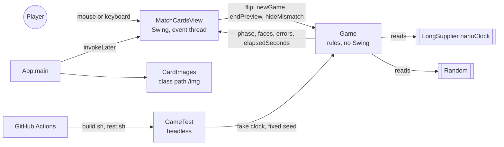

# Design: Card-Game

Date: 23 Nov 2026. Phase 2. Status: awaiting approval.
Tier A. One player, one laptop, no stored data, no network. Line numbers refer to `match card game demo/src/MatchCards.java` at b516f15. Phase 2 changes no code.

Guiding rule: keep what exists unless a Phase 1 number or risk shows it fails. Each decision below says keep or change and names the number or risk behind a change.

## (a) Major decisions

### D1. Language and UI toolkit: keep Java 21 and Swing (decision 0003)
| Option | Cost | Risk | Reversibility | Pick when |
|---|---|---|---|---|
| Keep Java 21 and Swing | None | Swing is old but ships in every JDK | Fully | No Phase 1 number fails because of Swing. Recommended |
| Move to JavaFX | 4 to 6 hours, plus a separate download since JavaFX left the JDK | New dependency, new build steps | Costly | A need for animation or CSS styling appears. None is in scope |
| Port to a browser (TypeScript or similar) | 8 hours or more | A rewrite with no measurement behind it; out of scope list | Costly | The goal changes to play in a browser |

Keep. Every failing number (clock, shuffle, fresh clone, keyboard) traces to code shape or missing build files, not to Swing.

### D2. Code structure: split the rules out of the view (decision 0004)
| Option | Cost | Risk | Reversibility | Pick when |
|---|---|---|---|---|
| Keep one class, state read back from button icons | None | Fails F6 and A6: no rule can be tested without a window (lines 160, 171, 252) | Fully | Never, given F6 |
| Extract a `Game` rules class with no Swing imports; the view draws from it | 2 to 3 hours | Play could change during the move (risk 7). Tests pin rules first | Yes, one revert | Recommended |
| Full model, view and controller layers with listeners and events | 4 to 5 hours | More code than 270 lines of game need | Yes | A second view (for example a text version) is wanted |

Change. Risk 6 and acceptance test A6 show the current shape fails. `Game` takes an injected `Random` (fair shuffle, Q5) and an injected clock (Q4).

### D3. Build and repository layout: plain `javac` scripts, standard folders (decision 0005)
| Option | Cost | Risk | Reversibility | Pick when |
|---|---|---|---|---|
| Plain `javac` and `java` in three small shell scripts, plus the same commands in the README | 1 hour | Windows users need the README commands, not the scripts | Fully | No outside libraries. Recommended, and the accepted default (assumption 9) |
| Gradle with the wrapper | 1 to 2 hours, plus a network download on first run | A wrapper jar in the repository, more to explain, build time on a fresh clone | Yes | Libraries arrive, or packaging grows |
| Maven | 1 to 2 hours, plus downloads | XML weight for two source files | Yes | Same as Gradle, if Maven is already familiar |

Change: add scripts and move to `src/main/java/matchcards`. Q9 and A2 fail today because no command exists. Measured on 23 Nov 2026: `javac -Xlint:all` on both files took 0.42 s real time on Java 21.0.6, so plain `javac` leaves almost all of the 5 minute budget.

### D4. Test approach: a small in repository test runner, no library (decision 0006)
| Option | Cost | Risk | Reversibility | Pick when |
|---|---|---|---|---|
| A plain Java test class with a `check` helper and a `main` that exits 1 on any failure | 30 minutes | Fewer features than JUnit; a runner bug could hide a failure, so one test proves a failing check gives exit 1 | Fully | No dependency allowed by default. Recommended |
| JUnit 5 console launcher jar | 1 hour, plus a network download and a jar in the repository or a script that fetches it | Supply chain item; outside action | Yes | Tests grow past about 30, or the author wants JUnit practice |
| Java `assert` statements run with `-ea` | 15 minutes | Silently skipped if `-ea` is forgotten | Yes | Never as the only check |

Change: there are no tests today (A6 fails).

### D5. Clock: elapsed time from a start instant, not by counting ticks (decision 0007)
| Option | Cost | Risk | Reversibility | Pick when |
|---|---|---|---|---|
| Keep the tick counter and add `gameTimer.start()` to Restart | 5 minutes | Fixes F3 only. Counts late ticks as lost time (risk 15). Still untestable | Yes | A one line hotfix is all that is wanted |
| `Game` stores a start reading from an injected monotonic clock (`System.nanoTime` in play, a fake in tests). A Swing timer only repaints the label every 250 ms | 1 hour | Small change to when the clock starts | Yes | Recommended |
| `java.time.Clock` with `Instant` | 1 hour | Wall time can jump when the system clock changes | Yes | Real dates are ever shown |

Change. Q4 fails today after a win and restart. The clock starts when the preview ends, not at window open (defect 4); that is a small change in reported times and is question 2 for the user.

### D6. Keyboard play and screen reader names: keep `JButton`, make it focusable (decision 0008)
| Option | Cost | Risk | Reversibility | Pick when |
|---|---|---|---|---|
| Keep `JButton` cards. Remove `setFocusable(false)`. Arrow keys through key bindings on the board panel. Space already presses a focused `JButton`. Set an accessible name per card | 1 to 2 hours | Focus ring look varies by look and feel | Yes | Recommended |
| A custom painted board with its own key listener | 3 to 4 hours | Loses the built in button access support | Yes | Never at this size |
| Mouse only, documented as a known limit | None | Fails F7 and A7 | Yes | The author drops F7 |

Change. A7 fails today (lines 105, 152).

### D7. Card art: replace with the Kenney Playing Cards Pack (decision 0002, now accepted)
Options table is in docs/decisions/0002-card-art.md. Change: rights unknown is risk 1, the highest damage item. The pack page, read again on 23 Nov 2026, says CC0 but does not list its cards, so assumption 14 is checked before any file is replaced. Images keep loading from the class path, as today (keep).

### D8. Code license: MIT for code, images credited separately (decision 0010)
Options table in docs/decisions/0010-code-license.md. Change: there is no LICENSE today (risk 11).

### D9. Hosting, data store, authentication, background work: does not apply (decision 0009)
The game is a local program. It serves nothing, stores nothing and has one player with no account. Continuous integration runs on GitHub Actions, already where the repository lives. Reasons and the CI pricing check are in decision 0009.

## (b) Data model
Everything lives in memory inside one `Game` object and is gone on exit, as today. Nothing is persisted, so there is no schema and no migration.

| Field | Type | Meaning |
|---|---|---|
| `faces` | `List<String>`, size 20 | Face name at each board place, after the shuffle. Each of the 10 names appears exactly twice |
| `faceUp` | `boolean[20]` | Card shows its face (picked or matched) |
| `matched` | `boolean[20]` | Card belongs to a found pair |
| `first`, `second` | `int`, `-1` when empty | Places picked in the current turn |
| `errors` | `int`, at least 0 | Mismatched turns this game |
| `phase` | `enum Phase { PREVIEW, PLAYING, SHOWING_MISMATCH, WON }` | Replaces today's `gameReady` flag and the icon checks |
| `startNanos`, `stopNanos` | `long` | Clock readings in nanoseconds from the injected clock; `stopNanos` set at win |

How it changes today versus the design: today the state is spread over `JButton` icons, `card1Selected`, `card2Selected` and `gameReady`. In the design the view holds no game state; it holds only the 20 buttons and the loaded images, and redraws from `Game`.

How it may change later: board size could become a constructor value (rows times columns, even). High scores would add the first persisted data and would need a file format and a decision note; that is out of scope.

## (c) Component contracts

### `Game` (package `matchcards`, no `java.awt` or `javax.swing` imports)
```java
public final class Game {
    public static final int PAIRS = 10;
    public static final int CARDS = 20;
    public enum Phase { PREVIEW, PLAYING, SHOWING_MISMATCH, WON }
    public enum Flip { FIRST, MATCH, MISMATCH, WON, IGNORED }

    /** faceNames: 10 distinct, non blank names. rng: shuffle source. nanoClock: monotonic nanoseconds. */
    public Game(List<String> faceNames, Random rng, LongSupplier nanoClock);
    public void newGame();          // shuffle (Collections.shuffle with rng), all face up, errors 0, phase PREVIEW, clock reset and stopped
    public boolean endPreview();    // PREVIEW to PLAYING, all face down, clock starts. Returns false and changes nothing in any other phase
    public Flip flip(int place);    // place 0 to 19
    public boolean hideMismatch();  // SHOWING_MISMATCH to PLAYING, the two picks turn face down. False in any other phase
    public Phase phase();
    public int errors();
    public long elapsedSeconds();   // whole seconds, rounded down; frozen after WON; 0 during PREVIEW
    public String faceAt(int place);
    public boolean isFaceUp(int place);
    public boolean isMatched(int place);
}
```
Error cases:
* Constructor: `NullPointerException` for a null argument; `IllegalArgumentException` if `faceNames` is not 10 distinct non blank names.
* `flip`, `faceAt`, `isFaceUp`, `isMatched`: `IndexOutOfBoundsException` if `place` is outside 0 to 19. These are programming errors, so they throw.
* `flip` returns `IGNORED`, never throws, when the phase is not `PLAYING` or the card is already face up. Player actions that make no sense are ignored, matching today's behavior at lines 155 and 160.
* `flip` on a second card returns `MATCH`, `MISMATCH` (errors plus one, phase becomes `SHOWING_MISMATCH`), or `WON` (last pair, clock stops).
* `newGame` works in every phase. The view decides when Restart is enabled.

### `CardImages` (package `matchcards`, Swing allowed)
```java
final class CardImages {
    /** Loads /img/<name><EXT> for each face plus the back, scaled to width by height pixels. EXT is one constant: .jpg today, the Kenney file type after slice S1. */
    static CardImages load(List<String> faceNames, String backName, int width, int height);
    ImageIcon face(String name);   // IllegalArgumentException for an unknown name
    ImageIcon back();
}
```
Error cases: `IllegalStateException` naming the class path entry if a file is missing (as today at lines 194 and 211) or if it decodes to a width of 0 or less (a corrupt file, abuse case 4). Both happen at start, before the window shows.

### `MatchCardsView` (package `matchcards`, Swing)
```java
final class MatchCardsView {
    MatchCardsView(Game game, CardImages images, int previewMillis); // previewMillis 1500 in play
    void show();   // must run on the Swing event thread; IllegalStateException otherwise
}
```
Behavior contract: on each card action it calls `game.flip(place)` and redraws only the places that changed. On `MISMATCH` it starts the one shot hide timer, which calls `game.hideMismatch()`. Restart stops the hide timer first (risk 9), then calls `game.newGame()` and starts the preview timer, which calls `game.endPreview()`. On `WON` it shows the win dialog with `elapsedSeconds()` and `errors()`. Each card has an accessible name such as "Card 7, face down" or "Card 7, Ace of clubs".

### `App`
`main` calls `SwingUtilities.invokeLater` to build `Game`, `CardImages` and the view, then `show()`. A load failure shows an error dialog with the message and exits with status 1.

## (d) Response time budget
Network and server splits do not apply: there is no network and no server. The only request path is a click inside one process.

Card click to face shown, p95 at most 100 ms (Q1):
| Step | Budget |
|---|---|
| Operating system input to the Swing event thread | 30 ms |
| `Game.flip` | 1 ms |
| View update: `setIcon` and accessible name on at most 2 buttons | 9 ms |
| Repaint of 2 buttons with already scaled images | 30 ms |
| Spare | 30 ms |

Launch to playable window, p95 at most 3 s (Q2):
| Step | Budget |
|---|---|
| JVM start and class loading | 1.0 s |
| Load and scale 11 images, once | 0.5 s |
| Build, pack and show the frame | 0.5 s |
| Spare | 1.0 s |

None of these numbers is measured; they are budgets to check in Phase 4 with a timing log. Images stay scaled once at start (keep, lines 198 to 201), so a click never decodes an image.

## (e) Environments and configuration
| Environment | What runs | How it differs |
|---|---|---|
| Local play | `./run.sh` or the README `java` command on the author's Mac, JDK 21 | Real clock, `new Random()`, 1500 ms preview |
| Local test | `./test.sh` runs the test class with `-Djava.awt.headless=true` | Fixed seed `Random`, fake clock, no window. Headless mode proves `Game` needs no display |
| Continuous integration | GitHub Actions, Ubuntu runner, JDK 21, runs `build.sh` then `test.sh` | Same as local test. No secrets needed |
| Demo | A visitor's machine with a JDK, from the README | Same as local play |

There is no configuration file and no environment variable. Board size, preview time and image names are constants in code. A config loader and example environment file would add work for nothing, so Phase 3 records "does not apply" for them.

## (f) Monthly cost
| Scale | Cost | Basis |
|---|---|---|
| Now: a handful of players, a few CI runs a month | 0 dollars | Runs on each player's machine. GitHub billing page, read 23 Nov 2026: standard GitHub hosted runners are free in public repositories (https://docs.github.com/en/billing/managing-billing-for-your-products/managing-billing-for-github-actions/about-billing-for-github-actions) |
| Ten times | 0 dollars | More players add no shared load. CI runs grow with commits, not players |

First limit hit: not money. If the repository ever became private, GitHub Free includes a 12 dollar monthly compute allowance for Actions (same page), roughly 2,000 Linux minutes by my arithmetic, far above a 1 minute build. The first practical limit is screen size: the fixed board of 600 by 656 pixels plus two bars cannot shrink (defect 8), so a small laptop screen at high scaling is the first place it fails.

## (g) Architecture


## (h) Walking skeleton
The thinnest path that touches every part: `build.sh` compiles everything into an ignored `out/` folder; `test.sh` runs one headless test that calls `new Game(...).newGame()` and checks 20 places with each name twice; `run.sh` opens the window through `invokeLater`; the CI workflow runs `build.sh` and `test.sh` on a push. The "real host" at Tier A is the player's laptop plus the CI runner.

What already forms it: `App.java` and `MatchCards.java` compile with plain `javac` in 0.42 s and, by code reading, play a full game. Class path image loading and Swing timers work as they are. So the skeleton is mostly the existing program, moved into `src/main/java/matchcards`, plus three scripts, a `.gitignore`, a first `Game` with only `newGame` and the accessors, and one test. The view keeps its own logic until Phase 4 slice S2.

Rollback proof: check out the commit before the skeleton and run the README command from that commit, then return.
